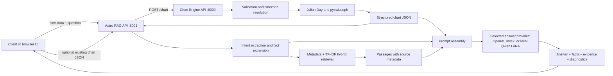
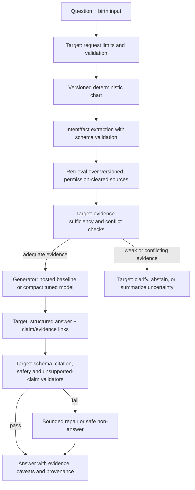

# Architecture

This document describes the checked-in implementation and a target architecture for reliability and a future compact model. “Current” labels identify behavior present in the code; “Target” labels describe work that has not yet shipped.

## 1. System boundaries



Chart Engine is the deterministic computation boundary: no LLM and no network access in the `generate_chart` calculation path. Astro RAG owns interpretation orchestration: chart acquisition, question decomposition, corpus retrieval and answer generation. Chart calculation calls are isolated in `app/chart_client/client.py`; the location-search proxy forwards through the configured Chart Engine URL.

## 2. Chart Engine internals (current)

Entry point is `chart-engine/app/engine/calculator.py::generate_chart`.

```text
Pydantic request validation
  -> semantic validation of date/time/coordinates
  -> IANA timezone lookup from coordinates (unless explicit)
  -> local civil time -> UTC, with DST ambiguity/nonexistence handling
  -> UTC -> Julian Day UT
  -> Swiss Ephemeris (or built-in Moshier fallback)
  -> sidereal/tropical positions using chosen ayanamsa
  -> angles and raw house cusps
  -> semantic houses + planet placement
  -> dignity, combustion, aspects, Vimshottari dasha
  -> chart summary, normalized fact keys/IDs, optional language facts
  -> internal invariant checks and provenance
```

Configuration is centralized in `chart-engine/app/config/`: supported settings and version constants, sign/planet/nakshatra tables, aspect rules and dignity rules. The chart output records schema/engine versions, input and calculation settings, timezone and ephemeris provenance, warnings and validation checks. A stable chart identifier is derived from the input block, settings and timezone; calculation timestamps are not stable identifiers.

The current semantic house-building path places planets using whole-sign houses based on ascendant sign. Raw cusps are also returned, but a setting accepted by the request model does not imply that every derived house interpretation is implemented for that system. Divisional charts and several strength/yoga systems are outside the current implementation.

Chart API errors use `ChartError` and a stable error code in a JSON object. DST ambiguity can require the caller to choose first or second occurrence. Geocoding endpoints call an external service; timezone lookup is local through timezonefinder. This distinction matters for reproducibility and privacy.

## 3. Astro RAG request lifecycle (current)

`POST /ask` in `astro-rag-new/app/api/ask.py` executes synchronously:

1. Use caller-provided `chart_json`, or call Chart Engine with birth details, coordinates and settings.
2. Resolve question facts in `app/facts/intent.py`. With `INTENT_MODE=auto` and an API key, the model proposes a bounded list of intents; values are validated against vocabularies and expanded from actual chart data in code. On failure, use deterministic rules. `rules` bypasses this model call. A generic question may fall back to a natal snapshot.
3. For each retrievable fact, run metadata/relevance retrieval and merge/deduplicate. `house_lookup` and `sign_lookup` facts are chart context and are not doctrine lookup targets.
4. Assemble chart summary, facts, source passages and the question into the answer prompt (`app/generation/prompt.py`).
5. Dispatch final answer generation to the selected provider: GPT-5-mini/OpenAI by default, deterministic mock mode when no OpenAI client is configured, or the optional local Astro Qwen adapter. Hosted empty/error handling remains structured, with a bounded token-exhaustion retry.
6. Return answer, facts used, passages, chart summary, model/mode, and generation status/usage. `include_debug` exposes the constructed prompts.

Intent extraction uses the configured OpenAI `LLMClient` (`INTENT_MODEL` or `OPENAI_MODEL`); selecting Qwen changes only final answer generation. The Transformers Qwen provider is lazy-loaded and cached in-process. It loads the `unsloth/Qwen3-4B-Instruct-2507-unsloth-bnb-4bit` base and `XeroxFlynn/astro-rag-lora-2` adapter with low-memory Transformers/PEFT options. On CPU-only machines it uses an explicit all-CPU device map to avoid automatic mixed CPU/disk placement; CUDA machines retain automatic placement. Its generation is greedy, capped at 700 new tokens, and uses a repetition penalty and Qwen end-token IDs when available. The separate Intel NPU provider uses OpenVINO GenAI and an exported, int4 OpenVINO IR produced by merging the same adapter into the matching unquantized Qwen3 base. It uses a plain composed prompt with OpenVINO chat templating disabled, repetition and stop-string controls, and defaults to 2,048 new tokens. The same setting configures OpenVINO's `MIN_RESPONSE_LEN` context reservation; together with `MAX_PROMPT_LEN=1024`, it may increase shared-memory demand and latency, but does not force the model to emit the full limit. NPU selection is explicit and never silently falls back to CPU. Neither local provider changes the intent-analysis model. Both paths still require sufficient runtime memory. NPU generation has returned visible output in controlled tests and the frontend; full-length generation at the configured cap still needs target-hardware validation. The RAG API response includes generation diagnostics, but the answer itself is plain text and no semantic claim/citation validator is currently applied.

The Transformers CPU path was adjusted after Transformers rejected the automatic mixed CPU/disk map for the quantized model. A small bitsandbytes 4-bit CPU forward-pass smoke check passed, but full Transformers CPU answer generation remains unverified on target hardware. Separately, the OpenVINO NPU path has returned an answer in the frontend. Do not infer successful long-form generation at its 2,048-token cap from that shorter end-to-end test.

### Browser UI (current, 2026-10-22)

Astro RAG serves a no-build HTML/CSS/JavaScript client from `app/static/`. New users enter local birth date/time and birthplace; place search goes to Astro RAG's same-origin `POST /location/geocode`, which forwards to Chart Engine. Successful searches are cached in process memory for one hour (maximum 128 entries), and uncached lookups are serialized at one request per second for the default public Nominatim provider. The map uses Leaflet and OpenStreetMap tiles with attribution.

After setup, the page shows a chatbot transcript and a sidebar with the active birth profile. Editing the profile affects subsequent requests; each transcript item keeps a snapshot of the profile used. Optional calculation and retrieval settings are collapsed under **Advanced settings**. The browser stores the profile, settings, selected theme and transcript in versioned `localStorage`; data is device/browser-local and has a clear-data control. This does not provide accounts, cross-device synchronization or server-side retention controls.

## 4. Corpus build and representation (current)

Inputs are four OCR PDFs under `astro-rag-new/rag/source_pdfs/`. `scripts/build_corpus.py` extracts text with PyMuPDF, applies deterministic cleanup and structure detection, and writes processed JSONL and a manifest. No LLM rewrites source text during ingestion.

```text
source PDF + SHA-256
  -> page-level extracted/cleaned text (pages.jsonl)
  -> chapter/section/rule/sloka-aware segmentation
  -> corpus.jsonl with retrieval text + metadata
  -> manifest with counts, detected coverage, hashes and notes
```

The corpus distinguishes source-derived passage text, raw/clean page material and `retrieval_text`. Chunks carry source/book/chapter/sloka/page provenance where recoverable, plus indexed concepts such as planets, houses, signs, topics and explicit relationship pairs. The manifest is the source of truth for build statistics and coverage. The current corpus has 2,800 chunks; Jataka Parijata has only detected Adhyaya 10–18, with missing coverage explicitly noted.

The source PDFs and processed corpus are distributed in this workspace. Before deployment or training, confirm rights for the particular editions, translations, OCR and derived data. Provenance metadata does not itself grant rights.

## 5. Retrieval internals (current)

`CorpusStore` loads the JSONL once at service startup and builds in-memory lookup structures. `semantic_search.py` uses scikit-learn TF-IDF; this is lexical/statistical text ranking, not a neural dense embedding model.

Supported strategies:

- `metadata_only`: exact relation metadata; zero results when no strict match exists.
- `semantic_only`: TF-IDF across corpus.
- `hybrid`: rank explicit metadata candidates semantically and reward explicit relation pairs; add a lower-weight metadata co-occurrence recall fallback and a small global semantic tail; add a limited life-topic boost; merge and deduplicate across facts and the raw question. Lower-ranked section overviews are removed when a same-book, same-chapter sloka is already present among the leading candidates.

The explicit relation metadata (e.g. planet-house pair versus loose co-occurrence) addresses a precision hazard in OCR-derived tagging. Scores are hand-designed ranking weights, not calibrated probabilities. Top-k relevance and faithfulness are not guaranteed by the score.

Current retrieval evaluation scripts create and compare query/chunk cases. Existing gold data and reports are regression tools, not a human-adjudicated benchmark. Metrics must be interpreted accordingly.

## 6. Prompt and evidence model (current)

The prompt gives the generator a chart snapshot, selected facts, source text and provenance, and the question. It asks the model to distinguish direct source claims from cautious traditional synthesis, cite passages, avoid unsupported doctrine and hedge interpretive tendencies. This is a prompt contract. It is not an output schema, a proof of grounding, or a guardrail that can guarantee compliance.

## 7. Target request lifecycle

The following is proposed for the dependable release; the boxes marked **Target** are not implemented today:



Keep rule calculation, source lookup and language generation separate. A custom model can be swapped behind the generator interface; it must not change the deterministic chart calculation or be the sole storage location for classical rules.

## 8. Target safety and reliability layers

1. **Input and service boundary:** authentication/authorization for public use, request and token limits, timeouts, rate limits, CORS allowlist and consistent error envelopes.
2. **Chart contract:** validate schema/version, required fields, settings and internal chart validation status; keep the effective `as_of_date` explicit for temporal facts.
3. **Question parser:** restrict model proposals to typed enums and bounded counts; validate every expanded fact against chart and supported feature set; abstain on unresolved intent.
4. **Evidence gate:** require traceable passage IDs; detect no evidence, OCR/coverage gaps and conflicting claims; prevent unsupported text from silently becoming doctrine.
5. **Generation contract:** structured fields for answer, claims, evidence IDs, interpretation labels, uncertainty and safety disposition. Treat question and retrieved documents as untrusted data, not instructions.
6. **Output verification:** check JSON/schema, citation IDs, quote fidelity if quoting, claim-to-evidence support, prohibited certainty, and no fabricated chart fact. A language-model judge may flag review candidates but should not be the only gate.
7. **Privacy and observability:** minimize logs, redact identifiers, avoid prompt/body capture by default, bound retention and isolate user records if persistence is added.
8. **Release management:** version chart engine, corpus build, prompts, model/tokenizer and evaluation data; rerun locked component and safety suites on changes.

Guardrails should not convert the product into a guaranteed prediction service. For health, death, self-harm, legal or financial topics, respond with non-deterministic framing and appropriate professional support boundaries.

## 9. Custom compact model architecture

This target describes the future project-trained ~1B model. The current optional local generator is a fine-tuned Qwen3-4B LoRA adapter loaded for final answers; its training pipeline is not part of this repository. Any future compact model should take a domain-adapted generator role, and possibly perform structured intent extraction, while retrieval supplies current doctrine and Chart Engine supplies calculations.

```text
Base instruction model (~1B, license/language reviewed)
  + supervised LoRA/QLoRA adapter trained on curated examples
  + prompt + current chart/facts/evidence
  -> structured answer
  -> deterministic validators and eval gates
```

Recommended investigation order:

- First improve/evaluate question parsing, corpus coverage, retrieval and prompt structure. These often change answers without training.
- Compare a licensed open-weight model at the target size with the hosted baseline and an untuned baseline on a locked, expert-reviewed suite.
- Use parameter-efficient supervised fine-tuning as an initial experiment, rather than training weights from scratch. Consider continued pretraining only if domain-language tests demonstrate need and source rights permit it.
- Use preference training only with reviewed preference pairs and clearly stated dimensions (grounding, citation accuracy, clarity, safe uncertainty).
- Evaluate quantized inference on actual hardware; parameter count alone does not establish deployability or quality.

Training examples should contain versioned input, question, chart context, evidence passages and source IDs, ideal answer, labels for claims/uncertainty/refusal, provenance and review status. Use synthetic charts or explicitly consented/anonymized data. Do not put unsupported claims, unreviewed OCR artifacts or test-set paraphrases into training data.

## 10. Evaluation design

### Initial end-to-end evaluation implementation

`astro-rag-new/rag/evaluation/evaluate_end_to_end.py` consumes a 20-case JSONL dataset. Each case pins synthetic birth inputs, chart settings and `as_of_date`, expected chart facts, source chunk/page references, acceptable answer points and prohibited claims. The split is 12 development and 8 holdout cases.

Retrieval-only mode calls Chart Engine, uses deterministic rule-based intent parsing and local corpus retrieval, and does not call a language model. Full mode calls `/ask`, then sends the answer, chart facts, retrieved passages, gold evidence and case constraints to a separately configured `EVAL_JUDGE_MODEL`. Reports include Hit@1/3/5, Recall@1/3/5, precision@k and MRR, plus five diagnostic judge dimensions: chart consistency, evidence support, citation validity, relevance and uncertainty/safety. Each report records a corpus hash and model/usage metadata when available, with separate development and holdout summaries.

The judge is a review aid, not an authority on astrological interpretation. Reviewers must compare every answer and citation with the source pages. Cases without expected supporting corpus passages are not scored on retrieval. The suite is synthetic and exploratory until subject-matter reviewers adjudicate its evidence and acceptable answer labels.

The optional `/ask` `as_of_date` is forwarded by the chart client when birth inputs are used. When omitted, Chart Engine continues to use its current-date default. A supplied `chart_json` is used unchanged.

### PDF text audit

`scripts/audit_pdfs.py` uses the same PyMuPDF extraction call as the corpus builder and compares the four source PDFs with `pages.jsonl`, checking SHA-256, empty/short text pages, extraction differences and detected chapter coverage. It reports extracted-text issues; it does not establish semantic OCR accuracy. Known blank text pages and incomplete Jataka Parijata coverage remain explicit corpus limitations.

Use separate suites so a fluent answer cannot hide a chart or retrieval defect:

| Component | Ground truth / metric examples |
|---|---|
| Chart engine | Reference chart inputs, precise expected positions/settings, boundary and DST cases, explicit tolerances |
| Intent extraction | Expected typed facts, JSON/schema validity, false positive/abstention rate |
| Retrieval | Human-labeled relevant passages; Recall@k, MRR/nDCG, relation precision, per-source/topic/OCR slices |
| Evidence and answer | Citation correctness, factual support, contradiction handling, missing-evidence abstention, expert-rated clarity |
| Safety | High-stakes determinism, harmful dependency, prompt injection, prompt/data leakage, out-of-domain requests |
| Operations | Latency, timeout/retry rates, error classes, token/API cost or local memory/throughput |

Use a locked holdout divided by source rule or chart archetype, not merely random paraphrase, and retain human adjudication. Automated metrics and LLM judges provide triage signals, not final proof of correctness.

## 11. Deployment and module map

Two independent FastAPI services are intended. Each Dockerfile builds one service. Development uses separate processes and ports; a future production deployment should put authenticated APIs behind a controlled gateway and configure secrets externally.

```text
chart-engine/app/astronomy/       timezone, Julian day, Swiss Ephemeris
chart-engine/app/engine/          positions, houses, aspects, dashas, assembly
chart-engine/app/config/          calculation tables/settings
chart-engine/app/api/             chart, location, health routes
astro-rag-new/app/chart_client/   HTTP boundary to Chart Engine
astro-rag-new/app/facts/          intent, parser, chart reader, vocab
astro-rag-new/app/retrieval/      store, metadata, TF-IDF, hybrid merge
astro-rag-new/app/generation/     prompts, OpenAI/mock client, and optional local Qwen adapter client
astro-rag-new/rag/                source PDFs, generated corpus, evaluation
```

## 12. Design constraints and known risks

- The two services currently use separate schemas with a thin integration contract. Add explicit schema compatibility checks when that contract changes.
- `chart_json` is accepted as an arbitrary dictionary; callers can supply malformed or inconsistent data. Target schema validation must cover externally supplied charts.
- CORS is permissive in both services; there is no built-in authentication or rate limiting.
- In-memory TF-IDF and corpus loading are appropriate for a small local corpus; index reloads require process restart. They are not a multi-tenant persistence design.
- A current period is time-dependent. Recomputing with different effective dates can change it even when birth inputs match.
- OCR errors and partial Jataka Parijata coverage constrain what source claims can be answered.
- Model-generated answers can ignore prompt instructions. Current prompt wording and retrieval score alone cannot establish factuality.
